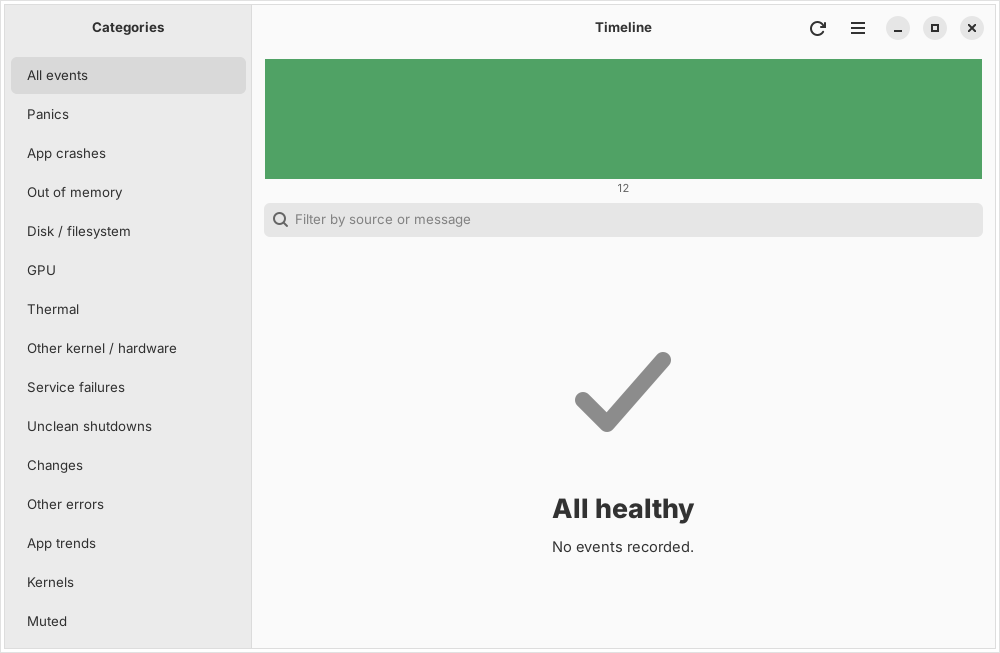

# relmon

A reliability monitor for Linux, in the spirit of the Windows Reliability Monitor. It reads the systemd journal
and coredumps into a local SQLite database and shows a 30-day score chart with a grouped timeline of
crashes, kernel/hardware errors (OOM, GPU, disk, thermal), failed services and unclean shutdowns.

Works on any systemd distribution. No distro-specific code.

## Features
- Daily score chart, per-category and per-day filtering, search with "show more"
- Journal context (±30 s) for each event, copy as a Markdown bug report
- Mute noisy events, per-app crash trends, per-kernel score comparison
- Desktop notifications for new panics and crashes (background timer)
- Headless text/Markdown report, light and dark themes, keyboard and screen-reader support

## Run
Needs Python 3, PyGObject, GTK 4 and libadwaita (e.g. `python3-gi`, `gir1.2-adw-1`).
Your user must be allowed to read the journal (group `systemd-journal`).

    python3 app.py                       # GUI
    python3 collector.py [--follow]      # collect once / keep collecting
    python3 collector.py --report --md   # last 7 days as Markdown (also: app.py --report, --days N)

The setup menu in the app can enable background collection (a systemd user timer) and an app-menu entry.

## Tests
    for t in tests/test_*.py; do PYTHONPATH=. python3 $t; done

`core.py` is pure logic with no GTK imports, so it can be ported on its own.

## License
GPL-3.0-or-later. See [LICENSE](LICENSE).
